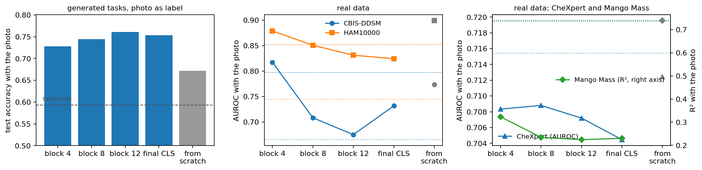

# table-image-icl

In-context learning on tables whose rows carry a photo.

<p align="center"></p>

A tabular in-context learner for tables whose rows come with a photo. Given labelled context rows, each with a photo, and test rows to predict, every test photo is read against the photos of its 32 nearest context rows and their labels, and what it reads joins the row as extra tokens inside a tabular in-context learner. The table stages are [TabICL v2](https://github.com/soda-inria/tabicl)'s, pretrained on synthetic tables; the image side is small and trained from scratch on synthetic tables whose rows are given real photos. Nothing is trained on the target data: a dataset is handed over as context and predicted in one forward pass, regression included.

Three things make it work:

- **Labels as values.** The image side's attention uses patch content for queries and keys, but the *label* of the source photo as the value. A test patch that looks like the patches of context photos labelled 5 reads back "5". ([`table_image_icl/reading.py`](table_image_icl/reading.py))
- **Retrieve, then read.** Each photo first picks the 32 context photos with the most similar mean token and reads from those only, so the attention it faces is the same size at 256 or 10,000 context rows. A model trained on 256-row tables extrapolates to 10,000 without retraining.
- **A pretrained table learner.** TabICL v2's column, row and in-context stages carry the table; the photo tokens are simply appended to each row before the row stage.

## Results

MulTaBench's four validation datasets, 256 labelled rows as context, three splits, no training on the data. Ours is the released block-4 model; the reference is MulTaBench's frozen-encoder baseline, TabPFN v2 on the table plus 30 PCA components of frozen DINOv2 features.

| | CBIS-DDSM (AUROC) | HAM10000 (AUROC) | CheXpert (AUROC) | Mango Mass (R²) |
|---|---|---|---|---|
| TabPFN v2, table only | 0.665 | 0.745 | 0.715 | 0.205 |
| TabPFN v2, table + frozen DINOv2 PCA | 0.797 | 0.852 | 0.720 | **0.736** |
| ours, table only | 0.679 | 0.743 | 0.706 | 0.222 |
| ours, table + photo | **0.817** | **0.879** | 0.708 | 0.323 |
| ours, photo of another row | 0.575 | 0.659 | 0.708 | 0.179 |

The photo adds about 0.14 AUROC on the two sets where it carries signal, and giving each row another row's photo takes it away again, so the model reads the photo rather than enjoying extra tokens. CheXpert's photos carry nothing for either method at this context size. On the regression set the from-scratch pixel arm reaches 0.739 (see the ablation below); the block-4 arm does not.

With more context rows at inference and no retraining (the in-context stage extrapolates, and the labelled read keeps its 32 neighbours):

| context rows | 256 | 512 | 1,024 | 4,096 | 10,000 |
|---|---|---|---|---|---|
| HAM10000, ours | 0.879 | 0.910 | 0.928 | 0.953 | 0.954 (4,980 rows) |
| HAM10000, frozen reference | 0.852 | 0.884 | 0.923 | 0.949 | 0.949 |
| CheXpert, ours | 0.708 | 0.726 | 0.743 | 0.767 | 0.780 |
| CheXpert, frozen reference | 0.720 | 0.744 | 0.759 | 0.773 | 0.781 |

The lead is a few-shot lead: largest at a few hundred rows, gone where both methods have thousands. Full records, including the ablation over which DINOv2 block feeds the image side, are in [`results/`](results/) and plotted in [`notebooks/results.ipynb`](notebooks/results.ipynb). MulTaBench's eight remaining image-table datasets ([`table_image_icl/multabench.py`](table_image_icl/multabench.py)) were held out and not scored during development.

<p align="center"></p>

## Install

```bash
git clone https://github.com/loevlie/table-image-icl && cd table-image-icl
pip install -r requirements.txt && pip install -e .
```

Python 3.11 or later and PyTorch 2.6. TabICL v2's weights come from Hugging Face and DINOv2's from torch hub, both on first use. The released weights of the block-4 model (108 MB) are on the [releases page](https://github.com/loevlie/table-image-icl/releases); put the file at `checkpoints/block4/model.pt`, next to its `config.json`.

## Use

```python
import numpy as np
from table_image_icl import load_run
from table_image_icl.inputs import inputs_for, letterbox
from table_image_icl.predict import predict_classes, predict_values

model, record = load_run("checkpoints/block4")
to_tokens = inputs_for(record["arm"], device="cpu", block=record["dino_block"])

photos = (np.stack([letterbox(p) for p in context_paths]), np.stack([letterbox(p) for p in test_paths]))
probabilities, classes = predict_classes(model, x_context, y_context, x_test, photos=photos, to_tokens=to_tokens)
values = predict_values(model, x_context, y_context, x_test, photos=photos, to_tokens=to_tokens)     # regression
```

`x_context` and `x_test` are float arrays with NaN for missing cells, `y_context` holds up to 10 classes or any regression target, and the photos are uint8 arrays of 224 px squares (`letterbox` makes them from paths). Without `photos` the model is TabICL v2 on the table.

## Reproduce

One A100 per run. The photo collections (about 20,000 photos from each of eight Hugging Face datasets) download on the first run; `--image-cache` keeps them decoded between runs.

```bash
# the released block-4 model: 25,000 steps, about 4 hours
python scripts/train.py --out runs/block4 --arm dino --dino-block 4 --max-steps 25000 --hours 5 --image-cache cache

# the other arms of the ablation
python scripts/train.py --out runs/block8  --arm dino --dino-block 8  --max-steps 25000 --hours 5 --image-cache cache
python scripts/train.py --out runs/block12 --arm dino --dino-block 12 --max-steps 25000 --hours 5 --image-cache cache
python scripts/train.py --out runs/cls     --arm dino_cls             --max-steps 25000 --hours 5 --image-cache cache
python scripts/train.py --out runs/pixels  --arm pixels               --max-steps 25000 --hours 5 --image-cache cache

# held-out generated tasks: the four views, per photo role
python scripts/evaluate.py --run runs/block4 --tasks-file evaluation-tasks.pt --out results/block4/evaluation.json --image-cache cache

# MulTaBench (downloads the datasets from Kaggle), at 256 and then at more context rows
python scripts/benchmark.py --run runs/block4 --out results/block4/multabench.json
python scripts/benchmark.py --run runs/block4 --out results/block4/multabench-context4096.json --max-context 4096 --max-sources 4096
```

Every run writes its full record (settings, library versions, machine, per-validation metrics) next to its weights, and a run started again with the same folder resumes from its checkpoint.

## Layout

```
table_image_icl/
  attention.py     multi-head attention and a pre-norm transformer layer
  images.py        patch embedders (pixels, DINOv2 tokens) and the per-photo encoder
  reading.py       the labelled read: nearest photos, then attention with labels as values
  tables.py        TabICL v2's stages, its preprocessing, and the slot bookkeeping it needs
  model.py         TableImageICL: the stages in sequence; load_run reads a run's folder
  inputs.py        from stored photos to the model's input: normalised pixels or frozen DINOv2 tokens
  collections.py   the photo collections (Hugging Face), training and validation splits
  tasks.py         the task generator: a prior table, a hidden variable, a photo per row, four views
  training.py      the loop, the schedule, checkpoints, the run record
  evaluation.py    scores by photo role and view; the share of the floor-to-ceiling gap closed
  predict.py       numpy in, probabilities or values out; regression as binned classification
  multabench.py    MulTaBench datasets and splits
  references.py    TabPFN v2, the frozen DINOv2 baseline, AUROC and R2
scripts/           train.py, evaluate.py, benchmark.py
notebooks/         each notebook is written by its make_*.py; edit the script, not the .ipynb
tests/             pytest; CPU, a few minutes; no downloads
results/           the records of the five runs in the ablation
```

## Notebooks

| Notebook | What it shows |
|---|---|
| [`walkthrough`](notebooks/walkthrough.ipynb) | One small table through the model, stage by stage, with each stage's code printed next to a run of it, and checks of what each stage is allowed to see. CPU, under a minute. |
| [`top_k_read`](notebooks/top_k_read.ipynb) | The top-k read written three ways, as a gather, a dense mask and a block-sparse kernel, with the same weights: identical outputs and gradients, and what that means for training memory. CPU, seconds. |
| [`results`](notebooks/results.ipynb) | One training task, one batch through the released model, and the figures: the four views, real data, which DINOv2 block, more context rows. Needs the released weights. |

To rebuild one: `python notebooks/make_walkthrough.py && jupyter nbconvert --to notebook --execute --inplace notebooks/walkthrough.ipynb`.

## Tests

```bash
pytest
```

The tests pin down what the pieces promise rather than what they output: a test photo influences only itself, every context label reaches the test photos, what is read back is the label and not the content, the top-k read reaches exactly the photos that retrieved a source, the masked read equals the gathered read in output and gradient, the model without photos equals TabICL v2's own forward, a run resumes from its checkpoint and refuses other settings. Tests that need TabICL's checkpoint skip when it is not in the Hugging Face cache.

## Acknowledgements

The table stages and the synthetic table prior are TabICL v2's ([Qu et al., 2025](https://github.com/soda-inria/tabicl), BSD-3). Frozen photo features are [DINOv2](https://github.com/facebookresearch/dinov2)'s ViT-B/14 with registers. The real-data benchmark is [MulTaBench](https://github.com/alanarazi7/MulTaBench) and the reference learner is [TabPFN v2](https://github.com/PriorLabs/TabPFN). The photo collections are the Hugging Face datasets listed in `table_image_icl/collections.py`.

## License

MIT. The released weights include TabICL v2's, which are BSD-3.
