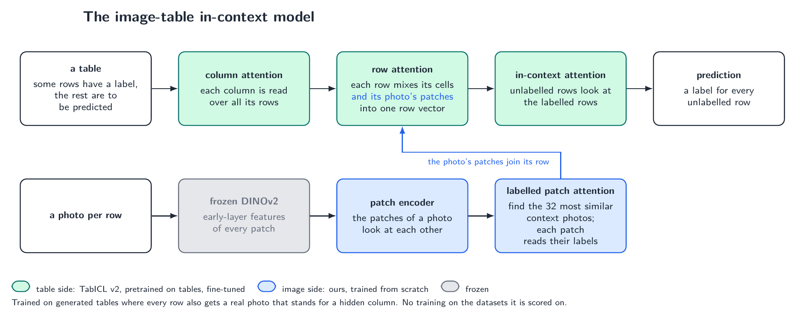

# table-image-icl

In-context learning on tables whose rows carry a photo. TabICL v2's pretrained table stages, plus a small image side that reads each row's photo against the photos of its 32 nearest labelled context rows. Hand it a labelled table with photos as context and it predicts the test rows in one forward pass, with no training on the data.

<p align="center"></p>

## Install

```bash
pip install -r requirements.txt && pip install -e .
```

Download the released weights from the [releases page](https://github.com/loevlie/table-image-icl/releases) to `checkpoints/block4/model.pt`. TabICL v2 and DINOv2 download themselves on first use.

## Usage

```python
from table_image_icl import load_run
from table_image_icl.inputs import inputs_for, letterbox
from table_image_icl.predict import predict_classes

model, record = load_run("checkpoints/block4")
to_tokens = inputs_for(model.cfg.encoder, "cpu")

photos = (np.stack([letterbox(p) for p in context_paths]), np.stack([letterbox(p) for p in test_paths]))
probabilities, classes = predict_classes(model, x_context, y_context, x_test, photos=photos, to_tokens=to_tokens)
```

`x_context`, `x_test` are float arrays with NaN for missing cells; `predict_values` does regression; without `photos` the model is TabICL v2.

## Results

Four MulTaBench datasets, 256 labelled rows as context, three splits, no training on them. The reference is MulTaBench's frozen-encoder baseline. These are datasets where the benchmark found that fine-tuning the encoder on the target helps, so the photo carries information that frozen features miss, which is what an in-context read of the photo can use. CBIS-DDSM, CheXpert and Mango Mass are scored with each patient or fruit kept on one side of the split (`scripts/benchmark.py --grouped`); HAM10000 has one image per lesion.

| | CBIS-DDSM | HAM10000 | CheXpert | Mango Mass (R²) |
|---|---|---|---|---|
| TabPFN v2, table | 0.659 | 0.745 | 0.728 | 0.224 |
| TabPFN v2, table + frozen DINOv2 PCA | 0.796 | 0.852 | **0.734** | 0.653 |
| ours, table + photo (block 4) | **0.808** | 0.879 | 0.721 | 0.343 |
| ours, table + photo (from scratch) | 0.750 | **0.899** | 0.720 | **0.732** |

Trained on tables of at most 256 rows, the model keeps improving when given up to 10,000 context rows at inference ([figure](assets/results/context.png)). On three extended-slice datasets where frozen features already suffice (PAD-UFES-20, SoCal Houses, DVM-Car) it keeps up on classification and trails on the two regression tables ([notebook section 7](notebooks/results.ipynb)). All records are in [`results/`](results/) and plotted in [`notebooks/results.ipynb`](notebooks/results.ipynb).

## Reproduce

One A100. Photo collections download from Hugging Face on the first run, MulTaBench from Kaggle.

```bash
python scripts/train.py --out runs/block4 --encoder block4 --max-steps 25000 --hours 5 --image-cache cache
python scripts/evaluate.py --run runs/block4 --tasks-file evaluation-tasks.pt --out results/block4/evaluation.json --image-cache cache
python scripts/benchmark.py --run runs/block4 --out results/block4/multabench.json
```

`--encoder pixels|block8|block12|cls` trains the other image encoders of the ablation and `--patch-read all` the read from every context photo instead of the 32 nearest; `--max-context 4096 --max-sources 4096` on `benchmark.py` scores with more context rows.

## Code tour

`python tour/app.py` serves http://127.0.0.1:8899: the model's files section by section (Code Hike scrollycoding), with what each section does, links to the upstream file at the pinned commit with the installed copy shown inline, tensor shapes recorded from a real run, hover definitions, and equivalence cards for every piece of code that is a port of someone else's (`tour/provenance.py`): our function against the upstream one in a Monaco diff, both outputs on one fixed input, a Hypothesis differential test over random inputs, and the pytest proof runnable from the page. `/classic` is the same tour as one plain page.

Build the page once with `cd tour/web && npm install && npm run build` (the server needs `pip install django pygments jedi`); regenerate the data under `tour/data/` with `python tour/trace.py`, `python tour/definitions.py` and `python tour/equivalence.py`.

## Notebooks

- [`walkthrough`](notebooks/walkthrough.ipynb): one small table through the model, stage by stage, with the code of each stage next to a run of it.
- [`results`](notebooks/results.ipynb): the figures behind the numbers above.

Tests: `pytest` (CPU, under a minute, no downloads).

## Acknowledgements

Table stages and prior from [TabICL v2](https://github.com/soda-inria/tabicl) (BSD-3); frozen features from [DINOv2](https://github.com/facebookresearch/dinov2); benchmark from [MulTaBench](https://github.com/alanarazi7/MulTaBench); reference learner [TabPFN v2](https://github.com/PriorLabs/TabPFN). MIT license.
